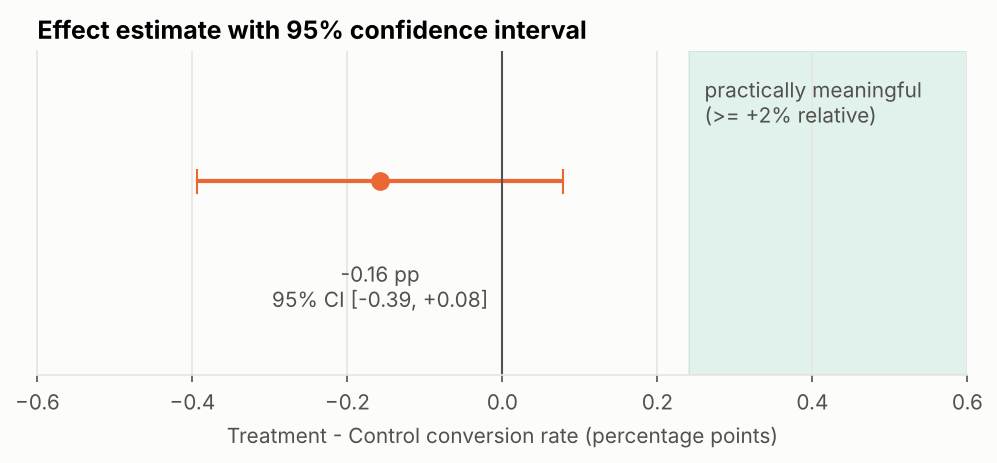
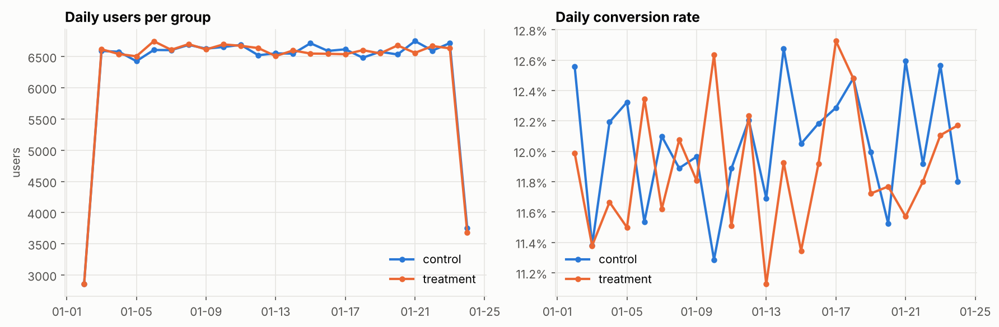
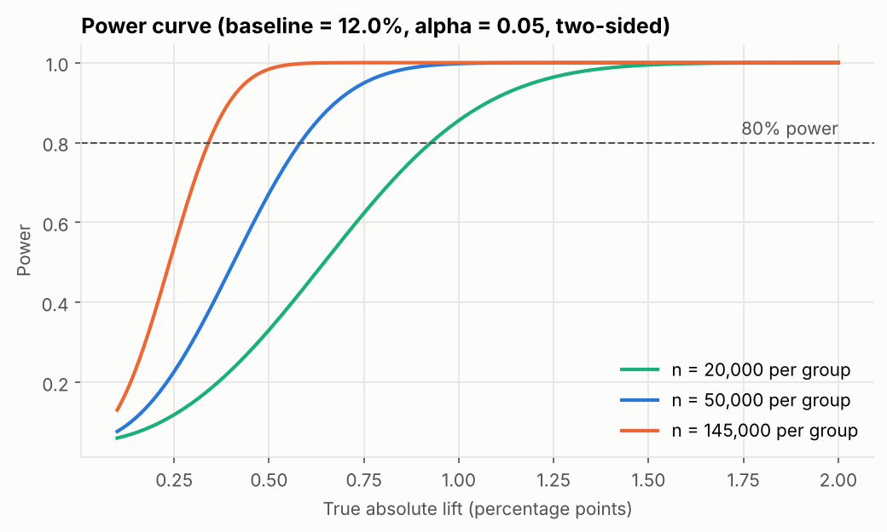
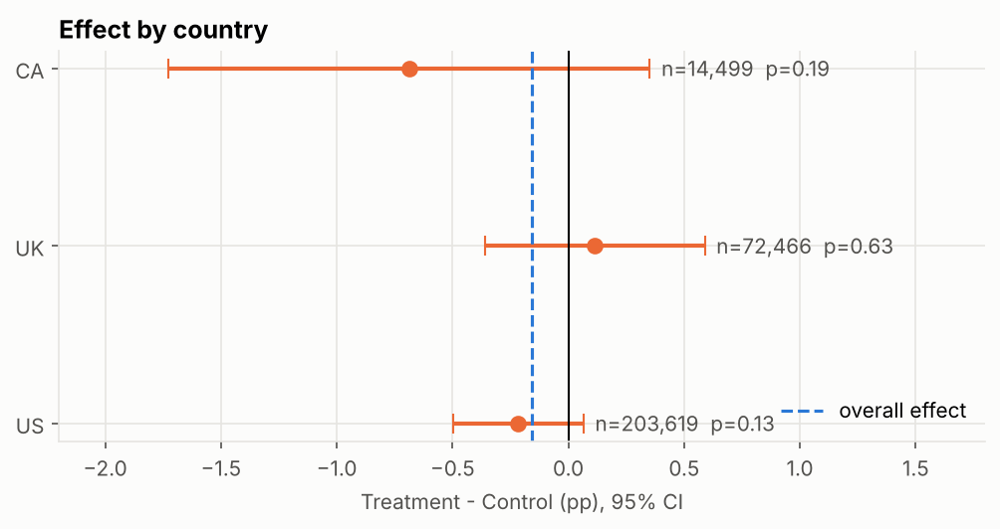
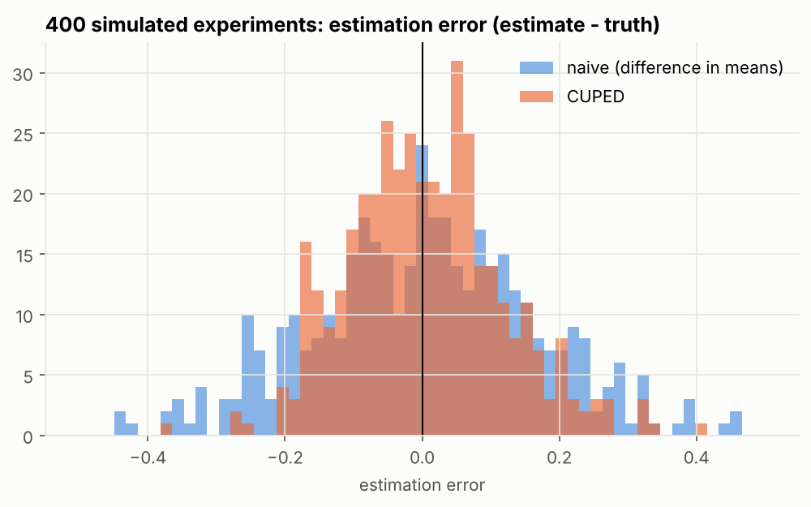
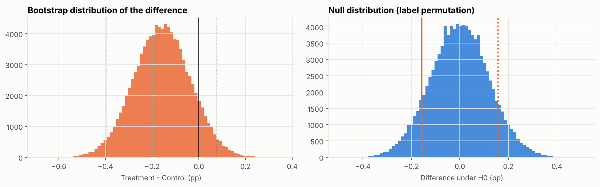
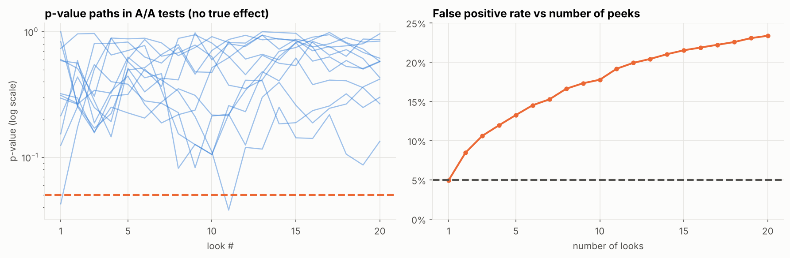

# E-commerce Landing Page A/B Test Analysis

[](https://github.com/mcfqq93-glitch/A-B-analysis/actions/workflows/tests.yml)


**English summary.** An end-to-end analysis of a real e-commerce A/B test (290k users, Udacity dataset): data-quality checks and Sample Ratio Mismatch, power analysis, two-proportion z-test, absolute and relative (delta-method) confidence intervals, bootstrap and permutation robustness checks, country segments with Holm/BH correction and a logistic interaction test, a CUPED variance-reduction demo, and a peeking simulation. Every statistical routine is implemented from first principles in `src/abtest/` and unit-tested against scipy/statsmodels. A Streamlit app turns the methods into a self-serve sample-size and significance calculator. **Recommendation: do not launch the new page.** The effect is −0.16 pp (95% CI −0.39 to +0.08, p = 0.19), and the CI rules out any lift above +0.66% relative.

---

## 项目概述

一家电商公司设计了新的落地页，想知道它能否比旧版本带来更高的购买转化率。本项目基于约 **29 万名用户**的真实随机实验数据，按照业界标准流程完成了从数据质量检查到上线决策的完整分析，并提供配套的交互式计算器。

| 问题 | 方法 | 结果 |
|---|---|---|
| 数据可信吗？ | 错配/重复清洗、SRM 卡方检验、协变量平衡 | 删除 1.3% 错配行；SRM p = 0.95 ✅ |
| 实验够灵敏吗？ | 功效分析与 MDE | 80% 功效下 MDE = 0.34pp（相对 2.8%） |
| 新页面更好吗？ | 双比例 z 检验 / 卡方检验 | 11.88% vs 12.04%，p = 0.19，不显著 |
| 效果有多大？ | Wald CI + Delta 方法相对提升 CI | 绝对 [−0.39, +0.08]pp；相对 [−3.2%, +0.7%] |
| 结论稳健吗？ | Bootstrap、置换检验 | 与 z 检验结果一致 |
| 对某些国家有效吗？ | 分群 + Holm/BH 校正 + 逻辑回归交互检验 | 各国均不显著；交互项 p = 0.29 |
| 如何让实验更灵敏？ | CUPED（模拟数据） | 方差 ↓57%，等价样本量 ×2.35 |
| 为什么不能中途偷看？ | A/A 实验模拟 | 偷看 20 次，假阳性率从 5% 升到 23% |

## 业务结论

> **不上线新页面。** 新页面的转化率没有显著提升，点估计甚至略低（−0.16 个百分点）。实验功效充足，95% 置信区间的上界只对应 +0.66% 的相对提升，已经排除了有业务价值的正面效果，因此也不建议延长实验。各国家分群的结论一致。

<p align="center">
  
</p>

<details>
<summary><b>更多图表</b></summary>

| | |
|---|---|
|  |  |
|  |  |
|  |  |

</details>

## 项目结构

```
├── notebooks/
│   ├── 01_data_quality_eda.ipynb          # 数据清洗、SRM、时间趋势、协变量平衡
│   ├── 02_core_hypothesis_testing.ipynb   # 功效分析、z 检验、置信区间、Bootstrap、上线决策
│   └── 03_advanced_methods.ipynb          # CUPED、分群与多重比较、交互检验、偷看模拟
├── src/abtest/
│   ├── stats.py        # 所有统计方法（从公式实现，附中文/英文注释）
│   ├── data.py         # 数据加载与清洗规则
│   ├── simulate.py     # CUPED 与偷看问题的模拟
│   └── plotting.py     # 统一的图表样式
├── app/streamlit_app.py   # 样本量规划 + 结果显著性计算器
├── tests/test_stats.py    # 与 scipy / statsmodels 交叉验证的单元测试
├── docs/
│   ├── learning_guide.md  # 每个方法的概念、假设、公式、解读（中文）
│   ├── interview_qa.md    # 32 道面试题与参考答案
│   └── study_plan.md      # 两周掌握计划
├── data/                  # 原始数据与模拟数据（见 data/README.md）
└── reports/figures/       # notebook 生成的图表
```

## 快速开始

```bash
git clone https://github.com/mcfqq93-glitch/A-B-analysis.git
cd A-B-analysis
python -m venv .venv && source .venv/bin/activate   # Windows: .venv\Scripts\activate
pip install -r requirements.txt

pytest -q                              # 运行单元测试
jupyter notebook notebooks/            # 按 01 → 02 → 03 顺序阅读
streamlit run app/streamlit_app.py     # 启动计算器
```

## Streamlit 计算器

- **实验前**：输入基线转化率、MDE、α、功效、分流比例和日流量 → 每组样本量、预计天数、功效曲线。
- **实验后**：输入两组用户数与转化数 → SRM 检查、z 检验、绝对与相对置信区间、当前样本量的 MDE，以及中文解读。

## 方法亮点

- **从公式实现**：z 检验、样本量、功效、MDE、Bootstrap、置换检验、CUPED、Holm/BH 全部手写，并通过单元测试与 scipy / statsmodels 对齐，确保"会用"也"懂原理"。
- **数据质量优先**：在看结果之前先做 SRM、错配、重复和协变量平衡检查。
- **决策导向**：同时报告统计显著性与业务显著性，用置信区间而不是 p 值来支撑"不上线"的建议。
- **诚实的局限说明**：公开数据没有实验前指标，所以 CUPED 用可复现的模拟数据演示，并用 400 次重复模拟验证无偏性。

## 局限与后续工作

- 数据只有一个主指标，缺少护栏指标（如加载时间、退款率）和用户属性（新老用户、设备）。
- 实验期约 3 周，无法评估长期效应。
- 可扩展：贝叶斯 A/B 测试、成组序贯检验（O'Brien–Fleming）、比率指标的 Delta 方法。

## 数据来源

Udacity *Analyze A/B Test Results* 项目数据集（`ab_data.csv`、`countries.csv`），详见 [data/README.md](data/README.md)。
